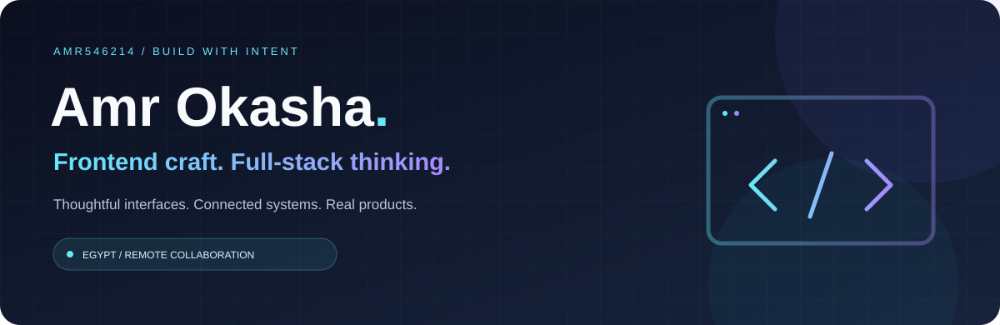

**Full-Stack Developer · Web and mobile products**

[Portfolio](https://portfolio-six-beta-fsv8cxz8pj.vercel.app/) · [Selected work](#selected-work) · [GitHub activity](https://github.com/Amr546214?tab=overview) · [Email](mailto:amr250010@gmail.com)

## About me

I'm **Amr Okasha**, a developer based in Egypt with 2+ years of frontend experience. I build product interfaces and the APIs, data models, and role-based workflows behind them.

## What I build

| Area | Tools I use |
| --- | --- |
| Web interfaces | React, Next.js, TypeScript, Tailwind CSS, Framer Motion |
| APIs and data | Node.js, Express, Supabase, PostgreSQL, Prisma |
| Mobile interfaces | React Native, Expo |
| Production and integrations | Angular, Docker, Vercel, n8n |

## Selected work

| Project | What I built | Explore |
| --- | --- | --- |
| **Waseet AI** | Designed and built a professional services marketplace across the frontend, API, and database. It covers project requests, proposals, delivery workflows, role-based dashboards, and AI-assisted features. | [Product website](https://waseetai.com/) |
| **TeamUP** | Built team formation and collaboration flows in a graduation project, including developer invitations, project views, and a team-leader dashboard. | [Source](https://github.com/Amr546214/team-up) · [Preview](https://team-up-one-pink.vercel.app/) |
| **AmrOS Portfolio** | Built a desktop-style portfolio with draggable windows, a mobile layout, and Supabase-backed content management. | [Source](https://github.com/Amr546214/portfolio) · [Live](https://portfolio-six-beta-fsv8cxz8pj.vercel.app/) |
| **Admin Dashboard** | Built a frontend demo with reusable tables, filters, CRUD screens, and loading states. | [Source](https://github.com/Amr546214/Admin-Dashboard) |

## GitHub activity

<table>
  <tr>
    <td width="56%" valign="top"></td>
    <td width="44%" valign="top"></td>
  </tr>
</table>

[View my contributions](https://github.com/Amr546214#year-list-container) · [Browse my repositories](https://github.com/Amr546214?tab=repositories)
