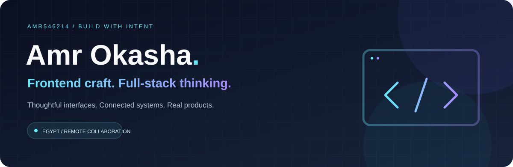
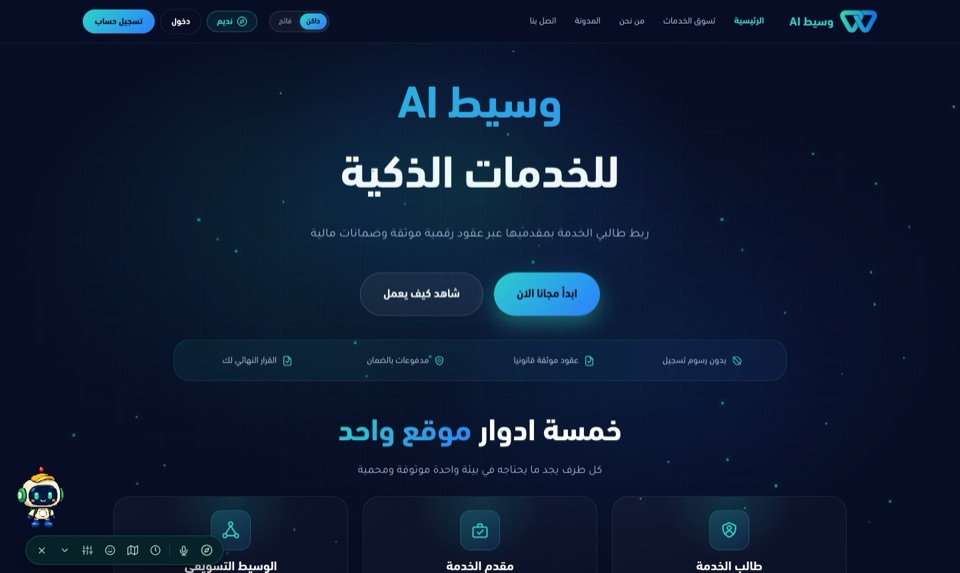
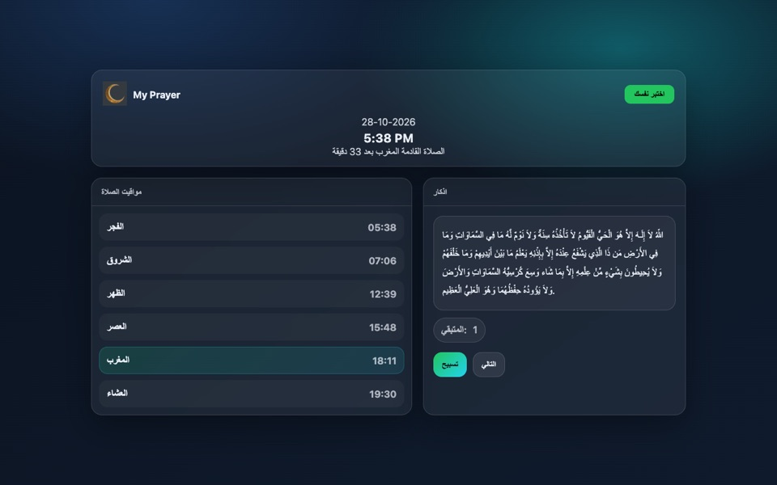
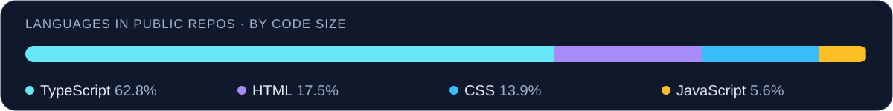

**Frontend developer growing into full-stack product work**

[Portfolio](https://portfolio-six-beta-fsv8cxz8pj.vercel.app) · [Selected work](#selected-work) · [Public repositories](https://github.com/Amr546214?tab=repositories) · [Email](mailto:amr250010@gmail.com)

## About

I'm **Amr Okasha**, a developer in Egypt with **2+ years of frontend experience**, now working across the stack. I like the part between a design and a dependable product: getting the interface right, connecting real data, handling the awkward edge cases, and following a feature through to release.

## What I build

- **Polished interfaces:** responsive layouts, reusable components, and clear loading, empty and error states, in Arabic (RTL) and English.
- **Real product flows:** authentication, role-based access, messaging, and payment integrations.
- **The layer behind the screen:** REST APIs, PostgreSQL schemas with Prisma, and containerised deployment.
- **Web and mobile:** React and Next.js for the web, Expo / React Native for apps.

## Stack

| Core: where I'm strongest | Working knowledge: used in real projects |
| :--- | :--- |
| React · TypeScript · JavaScript | Next.js · Expo / React Native |
| HTML · CSS · Tailwind CSS | Supabase · Node.js · PostgreSQL · Prisma |
| Responsive and accessible UI | Angular · Docker · n8n automations · Git |

Not every tool is at the same depth; the frontend ecosystem is my foundation. Parts of this come from work that is not public.

## Selected work

| Project | My role and what it shows | Links |
| :--- | :--- | :--- |
| **WaseetAI** | A services marketplace with client, provider, marketer and admin dashboards. I work on this platform with a team (team project, not solo): Angular frontend, Node.js / Express / Prisma / PostgreSQL backend, documented in both READMEs. | [Frontend](https://github.com/Amr546214/waaseetai_Front) · [Backend](https://github.com/Amr546214/waaseetai_Back) |
| **TeamUP** | A collaboration platform with client, developer, company and admin flows (React, Vite, Tailwind, Supabase, n8n). Team project; the public page is a pre-launch preview. | [Repository](https://github.com/Amr546214/team-up) · [Preview](https://team-up-one-pink.vercel.app) |
| **Ramadan App** | Prayer times from a public API, an azkar counter and a quiz, in Arabic RTL. A solo project. | [Repository](https://github.com/Amr546214/Ramadan-app) · [Live](https://ramadan-app-liard.vercel.app/) |
| **Portfolio** | React + TypeScript with Supabase and Framer Motion, styled as a desktop-like interface. | [Repository](https://github.com/Amr546214/portfolio) · [Site](https://portfolio-six-beta-fsv8cxz8pj.vercel.app) |

<table>
  <tr>
    <td width="50%"> WaseetAI: public home page</td>
    <td width="50%"> Ramadan App: prayer times and azkar</td>
  </tr>
</table>

## GitHub at a glance

Snapshot of 28 October 2026 from the GitHub API: 12 original public repositories (13 including this profile repo), no forks. Language shares measure code volume and include team-project code; they are not a skill rating. Commit, pull-request and rank counters are left out on purpose: most public pull requests belong to one team project's release workflow, and private work is not visible here. Data and method: [`assets/github-snapshot.json`](assets/github-snapshot.json).

## Let's talk

I'm looking for frontend and full-stack roles where careful UI meets real product work.

**[Portfolio](https://portfolio-six-beta-fsv8cxz8pj.vercel.app)** · **[Email](mailto:amr250010@gmail.com)**
