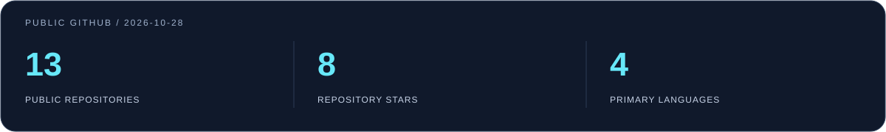

**Frontend Developer · Building across the stack**

[Portfolio](https://portfolio-six-beta-fsv8cxz8pj.vercel.app) &nbsp; / &nbsp; [Selected work](#selected-work) &nbsp; / &nbsp; [GitHub activity](https://github.com/Amr546214?tab=overview) &nbsp; / &nbsp; [Email](mailto:amr250010@gmail.com)

## A little about me

I'm **Amr Okasha**, a developer based in Egypt with **2+ years of frontend experience**, expanding into full-stack product development.

I enjoy the work between a design and a dependable product: getting the interface right, connecting real data, handling the awkward edge cases, and following a feature through to release.

- **Frontend first:** responsive interfaces, reusable components, and clear loading, empty, and error states.
- **Beyond the screen:** authentication, role-based workflows, API integration, real-time features, and payments.
- **Product mindset:** build it, verify it, refine it — with attention to the details users actually notice.
- **Growing across platforms:** web applications, Expo / React Native, and the backend systems behind them.

## My toolkit

| Focus | Technologies I work with |
| :--- | :--- |
| **Core frontend** | React · Next.js · TypeScript · JavaScript · HTML · CSS |
| **Interface & interaction** | Tailwind CSS · responsive design · Framer Motion |
| **Data & application features** | Supabase · REST APIs · authentication · real-time workflows |
| **Across the stack** | Node.js · PostgreSQL · Prisma · Angular |
| **Mobile & delivery** | Expo / React Native · Git · Docker · Vercel · Netlify |
| **Automation & integrations** | n8n · AI-assisted workflows · payment integrations |

These are areas of hands-on experience, not a claim of equal depth in every tool. React and the frontend ecosystem are my foundation.

## Selected work

| Project | What it demonstrates | Explore |
| :--- | :--- | :--- |
| **TeamUP** | A collaboration platform with client, developer, company, and admin flows. React, Vite, Tailwind, Supabase, and workflow integrations. | [Repository](https://github.com/Amr546214/team-up) · [Public preview](https://team-up-one-pink.vercel.app) |
| **WaseetAI** | Team contributions to a services platform spanning interfaces, API integration, administrative workflows, and delivery. Angular frontend and Node.js / Prisma backend. | [Frontend](https://github.com/Amr546214/waaseetai_Front) · [Backend](https://github.com/Amr546214/waaseetai_Back) |
| **Personal portfolio** | A React + TypeScript portfolio with Supabase and motion — a home for my work and experience. | [Repository](https://github.com/Amr546214/portfolio) · [Website](https://portfolio-six-beta-fsv8cxz8pj.vercel.app) |
| **E-Commerce** | A JavaScript storefront project exploring the shopping experience and interactive UI. | [Repository](https://github.com/Amr546214/E-Commerce) · [Website](https://shooopp.netlify.app/) |

*Project descriptions reflect the public repositories. WaseetAI is team work; the links do not imply sole authorship.*

## GitHub, in context

**Snapshot: 28 October 2026.** Counts cover the 13 public repositories returned by GitHub repository search for this account, including this profile repository. Stars are summed across those repositories. Primary languages are GitHub's repository-level classifications, not proficiency scores.

[Browse repositories →](https://github.com/Amr546214?tab=repositories) &nbsp; [See the current contribution graph →](https://github.com/Amr546214#year-list-container)

How this snapshot was checked

The figures come from public GitHub repository metadata. All 13 repositories in this snapshot are non-forks. Their primary-language breakdown is JavaScript (6), TypeScript (3), HTML (2), CSS (1), and no detected language (1). That is **four** detected primary languages; repositories without a detected language are excluded from that count.

Private work is excluded. Repository counts, stars, and contribution activity are signals of public activity — they do not determine seniority or engineering ability. Raw snapshot data is available in [assets/github-snapshot.json](assets/github-snapshot.json).

## Let's build something useful

I'm interested in frontend and full-stack opportunities where thoughtful UI meets real product work.

**[Explore my portfolio](https://portfolio-six-beta-fsv8cxz8pj.vercel.app)** · **[Get in touch](mailto:amr250010@gmail.com)**

---

Built with care. Kept honest. Always improving.
